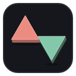
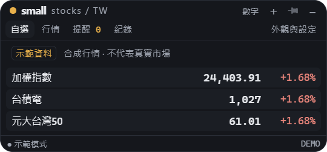
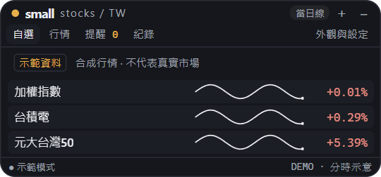
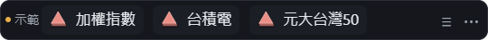
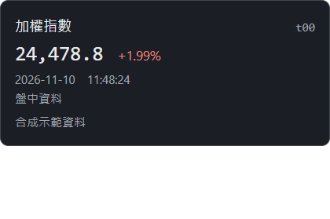
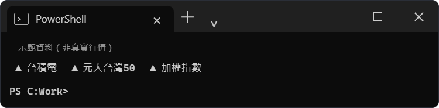
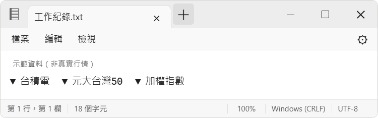
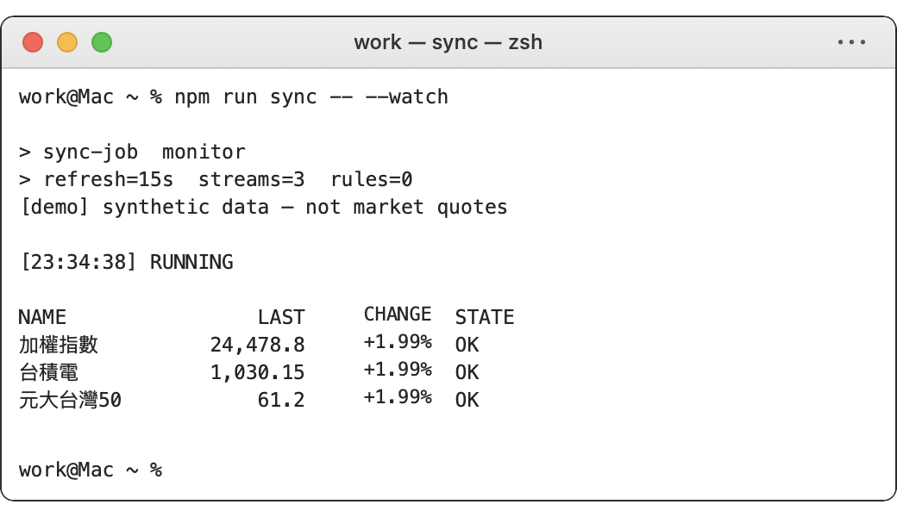
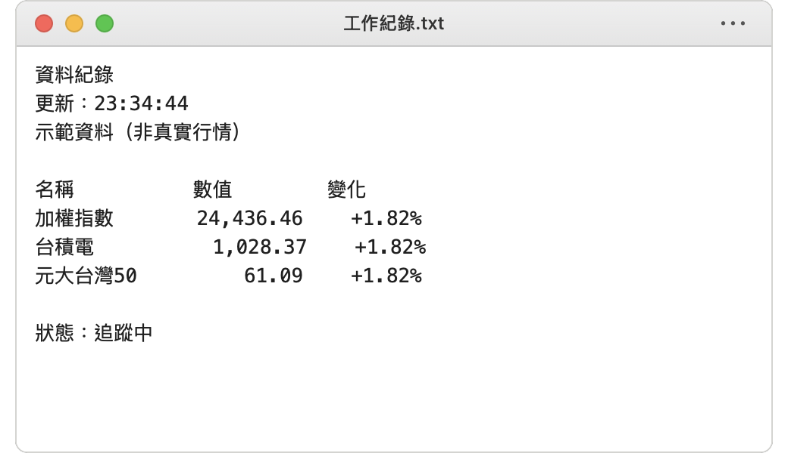

# SmallStocks TW

**Taiwan stocks, but small.**

A quiet desktop watchlist for the stocks you want to follow while working.

SmallStocks TW sits in a corner of your screen with a few Taiwan stocks, ETFs or market indices. Keep the numbers, switch to a tiny trend line, or show just a name and a triangular piece. When a price or percentage crosses a threshold you set, a short notice tells you. Choose the familiar small look, go grey, or turn the window into a terminal or a plain text report.

It runs on its own. If you use an agent, an optional local MCP connection lets it read the same watchlist and set the same alerts in natural language.

The Taiwan-stock sibling of [Basesmall](https://github.com/Zaious/basesmall) and [SmalLoL](https://github.com/Zaious/smallol), made with the same Tauri 2 desktop approach and visual language.

[繁體中文使用說明](docs/USAGE.zh-TW.md)



_Synthetic demo quotes, captured from the Windows app._

> **Status: 0.1.11 preview, Windows x64.** Portable ZIP and per-user installer on the [Releases page](https://github.com/Zaious/smallstocks-tw/releases). The Windows build is unsigned; code signing and automatic updates are not included. Full-session live-market validation is still pending.

## What it does

- **A small watchlist.** Search by name or code, or paste several codes at once. Follow listed and OTC stocks, ETFs, the TAIEX and the OTC index. Up to 30 watchlist entries.
- **Three ways to glance.** Numbers, a single-row trend, or just direction and name. The minimal small view becomes a roughly 30 px bar, wraps when narrowed, and reveals price, change and source time on hover. Stock codes are optional.
- **Four appearances.** Small in colour, small in greyscale, terminal and plain text. On Windows the latter two resemble Windows Terminal and Notepad; the macOS UI branch uses a zsh-style Terminal and a plain-text TextEdit window. These are appearances inside this app; they do not run a shell or edit your documents. Mac UI has browser-preview checks, not native Mac validation yet.
- **Alerts you choose.** Trade price, percentage, or bid/ask mid price crossing a threshold, upwards or downwards; once or once each trading day. Turn a rule off, record it quietly, or show a strip or card in the corner. Notices do not take keyboard focus.
- **Useful after the close.** The latest available official daily close, clearly dated, plus monthly open/high/low/close and volume history. Opening the app for the first time can fetch earlier daily records. Intraday trend mode can also retrieve the current day's available minute samples; gaps and partial data are labelled.
- **An optional agent connection.** Ask your agent to summarise the watchlist, inspect recorded events or create an alert. The desktop app keeps monitoring after the agent closes. No model account or API key is needed to use the app itself.
- **Fits your desktop.** Draggable, with optional always-on-top (on by default, saved across restarts) and a three-key hide-all shortcut: `Ctrl+Alt+S` on Windows, `⌘⌥S` on Mac. A pin button next to the minimise button toggles always-on-top. Minimise puts the window on the taskbar; closing it hides it to the tray (Windows 11 often keeps new tray icons in the hidden-icons area), and the same shortcut brings it back: it toggles, and the tray menu or launching the app again do the same. Choose Quit in the tray menu to stop it.

Red means up and green means down. The little triangular pieces have an equilateral face and a shallow side, carrying the small series' board-piece feel into a stock list. A dash means unchanged; an open circle means the direction is unconfirmed or the data is older.

## The small view

The small series uses restrained colours, rounded capsules and compact type to keep a watchlist in the corner of your desktop. Names stay readable, values align, and each normal row is only 22 px high. Small in colour uses Taiwan's red-up, green-down convention; its greyscale companion keeps the same shapes and layout.

| Display          | At a glance                                                                                       | Details                                                                                                                                                 |
| ---------------- | ------------------------------------------------------------------------------------------------- | ------------------------------------------------------------------------------------------------------------------------------------------------------- |
| Numbers          | Name, latest trade or official close, daily percentage change. Stock codes are optional.          | Hover a row for its code, date/time and price; click for daily history.                                                                                 |
| Single-row trend | The middle price slot becomes a tiny line; name and change stay in place, at the same row height. | During trading hours, today's minute samples; outside trading hours, recent daily closes. Hover identifies the chart source, time and partial coverage. |
| Minimal          | Just a triangular direction piece and a name, side by side when space allows.                     | Hover or keyboard focus opens a separate detail window with price, change, code, source time and data status. Click for daily history.                  |

**Single-row trend.** The chart uses the existing row rather than adding a chart panel or making the window taller:



_A synthetic session illustration. The actual chart shows the available portion of the session and labels partial coverage._

**Minimal and hover.** The equilateral pieces have a bright face and a shallow, darker side. The bar can shrink to roughly 30 px tall; the detail window appears outside it without enlarging the bar or taking keyboard focus:





_All images above use labelled synthetic demo data. Normal and trend rows use their row tooltip; the separate detail window shown here belongs to minimal mode. Neither hover nor switching modes interrupts monitoring._

## Four appearances, the same watchlist

Small colour and small greyscale share the board-piece styling and single-row charts. Terminal and notepad use greyscale text and their own window frames. All four support normal and minimal content, and share watchlists, rules and the always-on-top preference.




The Mac UI uses left-side traffic lights, a simple document title, Menlo-style text and a zsh prompt. Its plain-text view omits Windows tabs, the in-window menu bar and CRLF status strip:




_Mac appearances shown above are native window screenshots from an Intel Mac (macOS 26.2) running the demo mode with synthetic data. There is no macOS package yet; signing, real-market data, long-running use and the pressed-shortcut behaviour are not validated._

| Action                                                 | Windows                  | Mac UI       |
| ------------------------------------------------------ | ------------------------ | ------------ |
| Hide all windows and suppress notices, keep monitoring | Ctrl+Alt+S               | ⌘⌥S          |
| Open settings in terminal/text/minimal views           | Ctrl+,                   | ⌘,           |
| Text zoom / reset                                      | Ctrl++ / Ctrl+− / Ctrl+0 | ⌘+ / ⌘− / ⌘0 |

The hide-all shortcut works globally when registration succeeds. If another app occupies it, Settings reports the failure; the focused app's shortcut and hide controls remain available. The previous four-key shortcut has been replaced. Show the app from the tray to restore notices.

In **外觀與設定**, uncheck **視窗保持置頂** if you want other windows to cover the main window normally. The choice takes effect immediately and survives restarts and appearance changes. Hiding or covering the window does not stop monitoring; use Pause to do that. Alert cards and the temporary hover detail keep their independent overlay behaviour.

## Try it

Download from the [Releases page](https://github.com/Zaious/smallstocks-tw/releases), or build locally into `releases/`:

| Windows x64 | File                                          | Use                                 |
| ----------- | --------------------------------------------- | ----------------------------------- |
| Portable    | `SmallStocks-TW-0.1.11-windows-x64.zip`       | Unzip and run `smallstocks-tw.exe`. |
| Installer   | `SmallStocks-TW-0.1.11-windows-x64-setup.exe` | Installs for the current user.      |

The app needs Microsoft WebView2. These are unsigned preview builds; workplace device policies may prevent either package from running.

Start with **＋ → 管理自選** to add stocks. Use **數字 / 走勢 / 極簡** to change the display, and **外觀與設定** to pick a skin. Open **提醒** to set a threshold. Click a stock to see its daily history.

Want to look around outside trading hours? Run `Demo.cmd` from the portable package, or `smallstocks-tw.exe --demo`. This uses clearly labelled synthetic quotes and a separate default data folder. Quit the current instance from the tray before switching modes.

See the [Traditional Chinese guide](docs/USAGE.zh-TW.md) for controls, data handling and configuration.

## Agent / MCP, if you want it

Start the desktop app, then add this to a host that supports local stdio MCP:

```json
{
  "mcpServers": {
    "smallstocks-tw": {
      "command": "C:\\path\\to\\smallstocks-tw.exe",
      "args": ["--mcp"]
    }
  }
}
```

For example: “Watch 2330. When its traded price crosses below NT$1,000, show a grey strip, once per day.” Your agent can update the app's settings and create that rule. This is a configuration example, not a suggested trade.

The nine tools read status, daily and intraday history, events and rules, and manage the watchlist, settings and rules. Both the desktop interface and MCP use one local monitoring core. A rule continues without the agent; scheduled agent reports must be arranged in your agent host. The app does not bundle an LLM.

MCP connects over stdio to a token-protected loopback endpoint. Do not share `mcp-connection.json`. If your agent uses a cloud model, the information it reads may be sent to that model service. The [guide](docs/USAGE.zh-TW.md) includes the tool names and example rule fields.

## Data and privacy

Your computer fetches data directly. There is no developer-hosted quote server, account system or analytics. Settings, rules, events and caches are stored locally under `%APPDATA%\SmallStocks-TW` (macOS: `~/Library/Application Support/SmallStocks-TW`); demo mode uses a separate folder by default.

**Update check.** Once each time the app starts it asks GitHub whether a newer version exists (switch it off in Settings). Nothing about you is sent; GitHub sees an ordinary download request, and the developer sees only the download count GitHub publishes for the release file. An installed copy downloads and installs an update only when you press **Update** in Settings, after checking its signature; the portable zip only shows a link to the download page.

- **Quotes:** TWSE MIS, batched for the watchlist, every 15 seconds by default during weekday 09:00–13:30 Taiwan time. Errors back off. The app has not yet integrated the official holiday calendar.
- **Daily history:** official TWSE and TPEx sources, downloaded on demand and cached locally. Prices are unadjusted. The latest completed date depends on publication by the source.
- **Intraday lines:** Yahoo Finance minute samples where available, or clearly labelled local MIS observations. Chart samples are kept separate from alert evaluation and are never combined into a supposedly complete feed.

Source time and fetch time are separate. Missing, stale (older than three minutes) or out-of-order quotes cannot trigger alerts. During the session the source often gives no trade price for a stock and refreshes stocks only every one to two minutes; the app then shows the average of the best bid and ask, always marked as an order price (a "委" tag, a lighter arrow, `~` in the text skins) and never called a trade. Trade-price rules need a trade; the separate bid/ask mid rules say so in their notices. A crossing rule needs a baseline: starting the app above a threshold does not itself trigger an upward-crossing alert. Gaps between samples can still miss crossings.

This is a companion for keeping an eye on a watchlist. It does not place orders, read brokerage holdings, or provide tick-by-tick, large-order, volume-spike, price-limit-lock or announcement alerts. Market data is subject to its providers' terms; this project's software licence does not grant market-data rights. Local access and open source do not establish permission to redistribute data.

## Build from source

You need Node.js 24, Rust stable, Windows C++ build tools and WebView2.

```powershell
npm ci
npm run tauri dev
npm run tauri dev -- -- --demo
npm run tauri build -- --bundles nsis
```

Checks:

```powershell
npm test
npm run build
cargo test --manifest-path src-tauri/Cargo.toml --lib
```

For browser checks, run `npm run dev`, then `node scripts/minimal-check.mjs` or `npm run check:ui`. After a release build, `node scripts/desktop-minimal-check.mjs` checks the actual Windows app using its own test data folder. Other verification scripts and results are in [the implementation report](docs/IMPLEMENTATION_REPORT.md).

To package a portable build, run `./scripts/package-portable.ps1`. To regenerate the icon, see [the editable brand assets](assets/brand/README.md).

The [Traditional Chinese project website source](site/README.md) lives in `site/`. It reuses the small-series site design and app screenshots, with interactive display/platform previews and release-aware download links. Build it with `node site/build.mjs`; the page is served at [smallstocks.chroniclecore.com](https://smallstocks.chroniclecore.com) from a Cloudflare Worker, with the deployment settings kept in a private repository.

## Support

SmallStocks TW is free and stays free: no ads, no paid features, and no donation links inside the app. If it keeps you company at work, you can [buy me a coffee](https://buymeacoffee.com/zaious); it unlocks nothing, every feature is the same for everyone.

## Licence

Made by [Zaious](https://zaious.dev/) at [ChronicleCore Studio](https://studio.chroniclecore.com), 編年史記工作室.

[Apache License 2.0](LICENSE), with [NOTICE](NOTICE). Reuses our own Basesmall and SmalLoL desktop patterns and visual components. Market data and third-party trademarks are not included in the software licence. SmallStocks TW is an independent project, unaffiliated with TWSE, TPEx, Yahoo or any brokerage.
