<!-- readme-standard: 2.1.2; type: A; has: autoupdate,loopback,binaries; brands: TWSE,TPEx,Yahoo -->

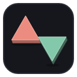

# SmallStocks TW

**Taiwan stocks, but small.**

Independent desktop watchlist for Taiwan stocks on Windows and macOS, with price alerts and optional MCP.
桌面角落的台股自選小窗

**[Download for Windows (.exe)](https://github.com/Zaious/smallstocks-tw/releases/latest)** · [macOS (.dmg)](https://github.com/Zaious/smallstocks-tw/releases/latest) · [Getting started](#getting-started) · [繁體中文使用說明](docs/USAGE.zh-TW.md)

<p align="center">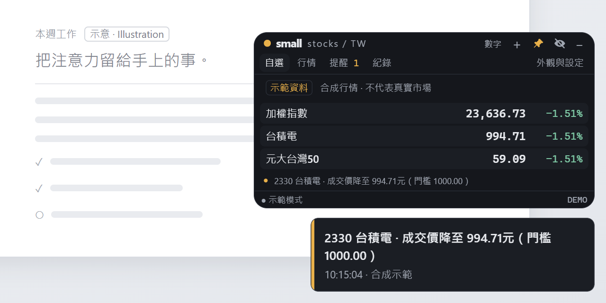</p>

<p align="center"><em>The watchlist stays in the corner while you work; a short card appears when a threshold you set is crossed. Composite: the work document is an illustration; the watchlist and the alert card are captured from the Windows app in demo mode, with synthetic quotes.</em></p>

SmallStocks TW keeps a few Taiwan stocks, ETFs or market indices in a corner of your screen while you work on something else. Keep the numbers, switch to a tiny trend line, or show just a name and a triangular piece. When a price or percentage crosses a threshold you set, a strip or card appears in the corner without taking keyboard focus, and you go back to what you were doing. It watches and tells you: it does not place orders, and the free TWSE source it reads refreshes a stock about every one to two minutes, so it is not a tick-by-tick feed.

> **Status: 0.1.16 · Windows x64 and macOS · the Mac build was run only briefly, on one Intel Mac.**

Free · no account or API key · no analytics in the app · Apache-2.0 (see [Privacy](#privacy) and [Licence](#licence))

## What it does

- **Keeps a few stocks in view while you work.** A small window stays in a corner of your screen, on top of other windows unless you switch that off. Follow listed and OTC stocks, ETFs, the TAIEX and the OTC index, and, as a preview, US tickers such as AAPL or TSM; up to 30 entries, found by name or code.
- **Tells you only when it matters.** Set an alert on the trade price, the percentage change or the bid/ask mid price crossing a threshold, or on a rapid move of X% within N minutes. Each fires once, or once each trading day, as a quiet strip or a card that does not take keyboard focus; or it is only recorded.
- **Sets up 20 stocks in one paste.** Paste names or codes (mixed, or copied from a broker app with prices in it), optionally with one alert per line such as `台積電 跌破 1000` or `0050 5分鐘內急跌 1%`. Every name is looked up and listed for you to confirm before anything is saved. A button copies instructions for a chat AI (ChatGPT and the like) to turn your list or a screenshot into that format; the app itself sends nothing to any AI.
- **Shows as much or as little as you like.** Numbers, a single-row trend line, or just a direction piece and a name. The minimal view becomes a bar about 30 px tall that shows price, change and source time on hover. Stock codes are optional.
- **Looks like something else, if you prefer.** Four appearances: small in colour, small in greyscale, a terminal and a plain-text file. A three-key shortcut, `Ctrl+Alt+S` on Windows and `⌘⌥S` on Mac, hides every window and notice while monitoring continues, and brings them back.
- **Stays useful after the close.** The latest official daily close, clearly dated, plus monthly open, high, low, close and volume history from TWSE and TPEx. During the session the trend view uses today's available minute samples; gaps and partial data are labelled.
- **Lets an agent help, if you use one.** An optional local MCP connection lets your agent summarise the watchlist, look at recorded events or create an alert in plain language. The app keeps monitoring on its own, and needs no model account or API key.

New here? Start with [Getting started](#getting-started).

## The small view

The small series uses restrained colours, rounded capsules and compact type to keep a watchlist in the corner of your desktop. Names stay readable, values align, and each normal row is only 22 px high. Small in colour uses Taiwan's red-up, green-down convention; its greyscale companion keeps the same shapes and layout. The little triangular pieces have an equilateral face and a shallow side. A dash means unchanged; an open circle means the direction is unconfirmed or the data is older.

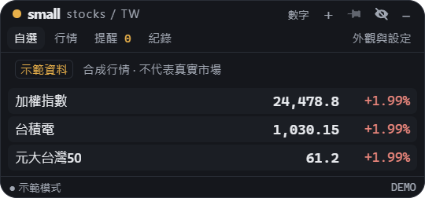

_Synthetic demo quotes, captured from the Windows app._

| Display          | At a glance                                                                                       | Details                                                                                                                                                 |
| ---------------- | ------------------------------------------------------------------------------------------------- | ------------------------------------------------------------------------------------------------------------------------------------------------------- |
| Numbers          | Name, latest trade or official close, daily percentage change. Stock codes are optional.          | Hover a row for its code, date/time and price; click for daily history.                                                                                 |
| Single-row trend | The middle price slot becomes a tiny line; name and change stay in place, at the same row height. | During trading hours, today's minute samples; outside trading hours, recent daily closes. Hover identifies the chart source, time and partial coverage. |
| Minimal          | Just a triangular direction piece and a name, side by side when space allows.                     | Hover or keyboard focus opens a separate detail window with price, change, code, source time and data status. Click for daily history.                  |

**Single-row trend.** The chart uses the existing row rather than adding a chart panel or making the window taller:

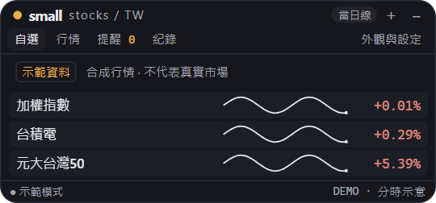

_A synthetic session illustration. The actual chart shows the available portion of the session and labels partial coverage._

**Minimal and hover.** The equilateral pieces have a bright face and a shallow, darker side. The bar can shrink to roughly 30 px tall; the detail window appears outside it without enlarging the bar or taking keyboard focus:

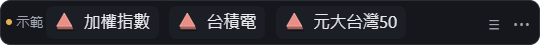

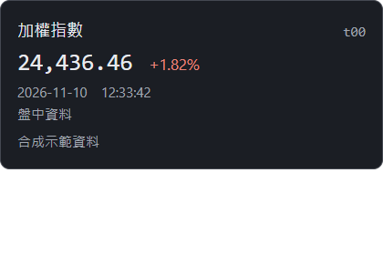

_All images above use labelled synthetic demo data. Normal and trend rows use their row tooltip; the separate detail window shown here belongs to minimal mode. Neither hover nor switching modes interrupts monitoring._

## Four appearances, the same watchlist

Small colour and small greyscale share the board-piece styling and single-row charts. Terminal and notepad use greyscale text and their own window frames. All four support normal and minimal content, and share watchlists, rules and the always-on-top preference. They are appearances inside this app: they do not run a shell or edit your documents.

<p align="center">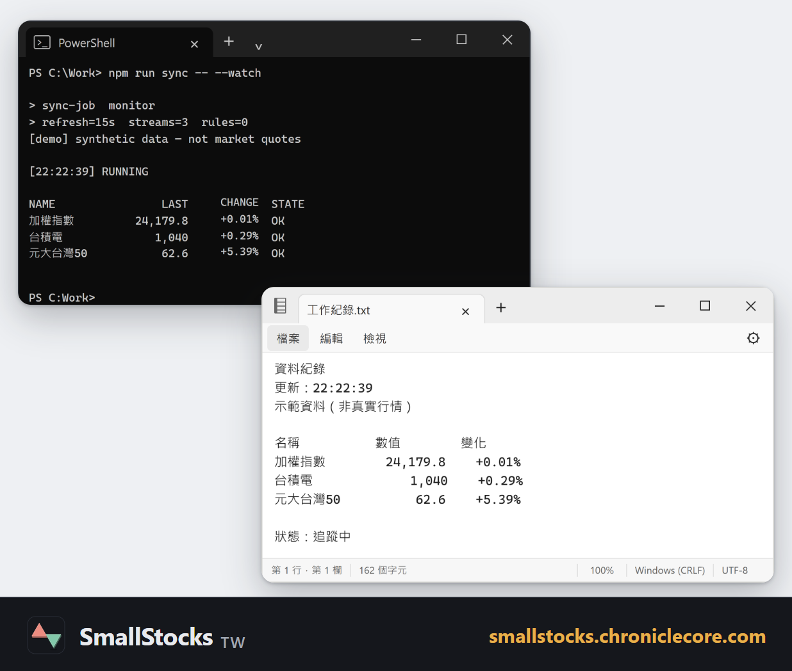</p>

<p align="center"><em>Windows: the terminal and the text-file appearances. Synthetic demo data.</em></p>

The same two in the minimal layout:

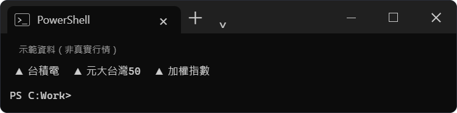
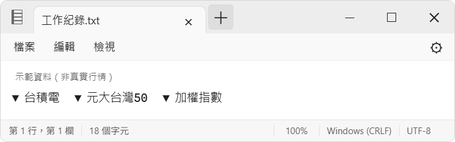

The Mac UI uses left-side traffic lights, a simple document title, Menlo-style text and a zsh prompt. Its plain-text view omits Windows tabs, the in-window menu bar and CRLF status strip:

<p align="center">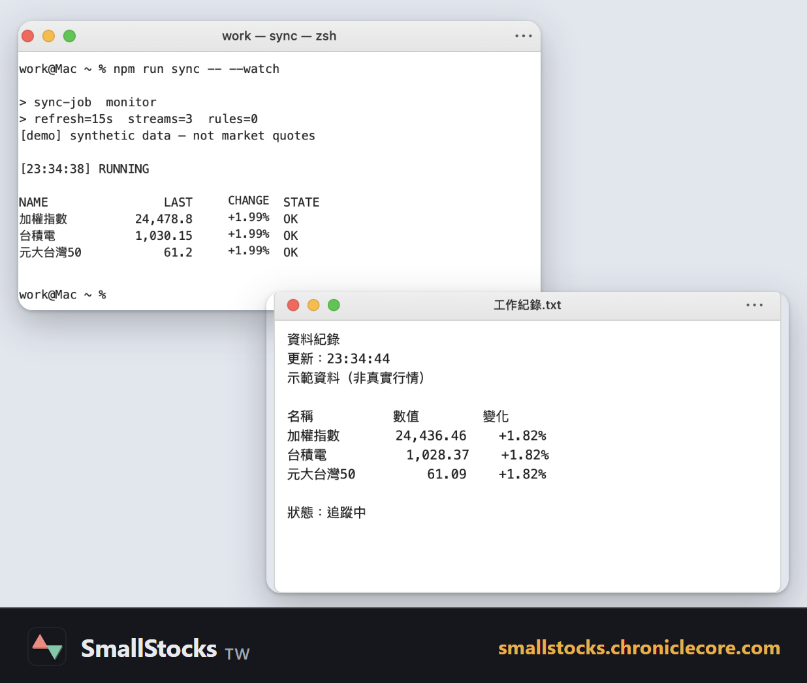</p>

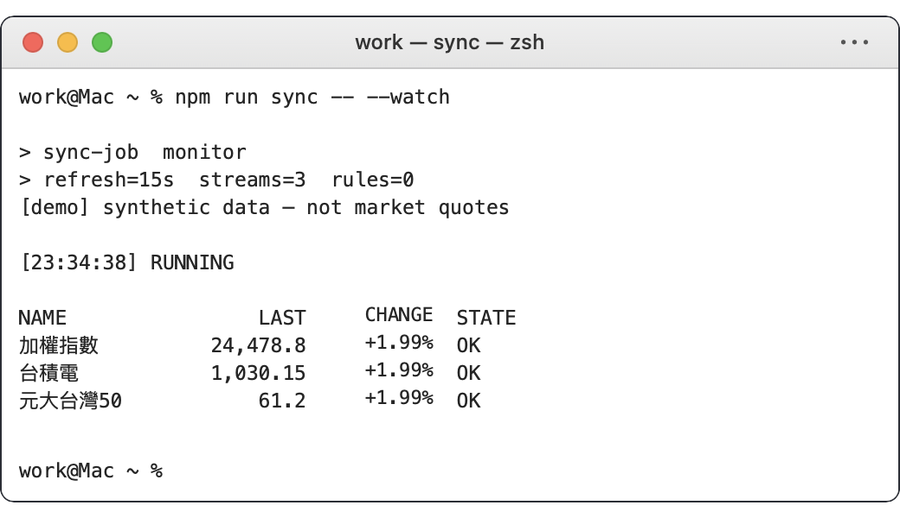
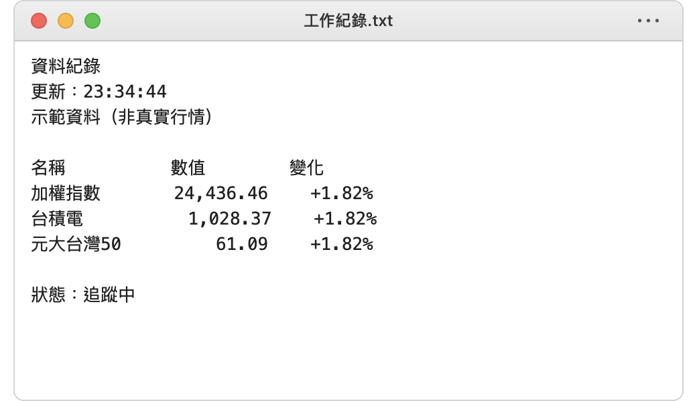

_Mac appearances shown above are native window screenshots from an Intel Mac (macOS 26.2) running the demo mode with synthetic data. The released Mac build was also run there for a few minutes on live quotes (data, hide/recall with `⌘⌥S`, data folder); Apple Silicon, long-running use and the notification window are not validated._

| Action                                                 | Windows                  | Mac UI       |
| ------------------------------------------------------ | ------------------------ | ------------ |
| Hide all windows and suppress notices, keep monitoring | Ctrl+Alt+S               | ⌘⌥S          |
| Open settings in terminal/text/minimal views           | Ctrl+,                   | ⌘,           |
| Text zoom / reset                                      | Ctrl++ / Ctrl+− / Ctrl+0 | ⌘+ / ⌘− / ⌘0 |

The hide-all shortcut works globally when registration succeeds. If another app occupies it, Settings reports the failure; the focused app's shortcut and hide controls remain available. Show the app from the tray to restore notices.

In **外觀與設定**, uncheck **視窗保持置頂** if you want other windows to cover the main window normally; the pin button next to **−** does the same. The choice takes effect immediately and survives restarts and appearance changes. **−** puts the window on the taskbar; closing it hides it to the tray, and the hide-all shortcut, the tray menu or starting the app again bring it back. Hiding or covering the window does not stop monitoring; use Pause to do that, or **結束程式** (or the tray menu's quit item) to stop it. Alert cards and the temporary hover detail keep their independent overlay behaviour.

## What it does not do

It does not place orders, read brokerage holdings or give investment advice. The free TWSE source refreshes a stock about every one to two minutes, so there are no tick-by-tick, large-order, volume-spike, price-limit-lock or announcement alerts, and a crossing between two refreshes can still be missed. Emerging-market (興櫃) stocks are not in that source. US tickers have no bid/ask mid and no daily history yet.

## Download

From the [latest release](https://github.com/Zaious/smallstocks-tw/releases/latest):

|                                 | File                                    | Notes                                                                                    |
| ------------------------------- | --------------------------------------- | ---------------------------------------------------------------------------------------- |
| Windows x64, installer          | `SmallStocks.TW_0.1.16_x64-setup.exe`   | Installs for your user only: no administrator rights.                                    |
| Windows x64, portable           | `SmallStocks-TW-0.1.16-windows-x64.zip` | Nothing to install. Unzip and run `smallstocks-tw.exe`; `Demo.cmd` starts the demo mode. |
| macOS (Intel and Apple Silicon) | `SmallStocks.TW_0.1.16_universal.dmg`   | Drag to Applications. Signed and notarised by Apple. Run only briefly, on one Intel Mac. |

> [!WARNING]
> **"Windows protected your PC"?** SmallStocks TW is not code-signed, so Windows shows a warning. Click **More info**, then **Run anyway**. For the portable zip you can also right-click the downloaded zip, open **Properties** and tick **Unblock** before you unzip it.

**Check the file.** Every file's SHA-256 is listed in `SHA256SUMS-0.1.16.txt` on the release page, and GitHub shows one next to each file. Compare it with:

```powershell
Get-FileHash .\SmallStocks.TW_0.1.16_x64-setup.exe -Algorithm SHA256
```

This guards against a damaged download, not against a tampered release page.

### Getting started

You need Windows x64 with Microsoft WebView2 (Windows 11 usually has it; on Windows 10 you may need to install it), or macOS. There is no account, API key or data subscription to set up.

1. Start SmallStocks TW. A small window opens and keeps itself above other windows.
2. Choose **＋** to add stocks by name or code, or paste a list (lines such as `台積電 跌破 1000` also create alerts). Press **檢查**, look over the results, then add them.
3. Open **提醒** to add or change an alert: the stock, what to watch, the direction, the threshold and how to be told.
4. Press **數字** to switch between numbers, trend and minimal, and open **外觀與設定** for the four appearances.

You should now see your stocks with their price and daily change. Outside trading hours the rows show the latest official close, and the status line says which day it is from. When a threshold is crossed, a strip or card appears in the corner of the screen.

To look around outside trading hours, run `Demo.cmd` from the portable zip, or start `smallstocks-tw.exe --demo`. It uses clearly labelled synthetic quotes and its own data folder. Quit the running copy from the tray first. The [Traditional Chinese guide](docs/USAGE.zh-TW.md) explains every control.

### Updates

Once each time it starts, the app asks GitHub whether a newer version exists; switch this off with **啟動時檢查新版本** in **外觀與設定**. GitHub sees an ordinary request, and nothing about you or your watchlist is sent. An installed copy downloads and installs an update only when you press **更新並重新啟動**; the portable zip never updates itself and only shows a link to the download page. Updates are checked against a signature before they install. This is separate from Windows code signing.

## Agent connection (MCP, optional)

Start the desktop app, then open **外觀與設定** and use the **agent (MCP)** buttons: they copy a JSON config, a `claude mcp add` command or a `codex mcp add` command with this program's real path filled in. Or add this by hand to a host that supports local stdio MCP:

```json
{
  "mcpServers": {
    "smallstocks-tw": {
      "command": "C:\\path\\to\\smallstocks-tw.exe",
      "args": ["--mcp"]
    }
  }
}
```

For example: “Watch 2330. When its traded price crosses below NT$1,000, show a grey strip, once per day.” Your agent can update the app's settings and create that rule. This is a configuration example, not a suggested trade.

The ten tools read status, daily and intraday history, events, rules and a backup of your setup, and manage the watchlist, settings and rules. Restoring a backup is only possible in the desktop app, never through MCP. Both the desktop interface and MCP use one local monitoring core. A rule continues without the agent; scheduled agent reports must be arranged in your agent host. The app does not bundle an LLM.

MCP connects over stdio to a token-protected endpoint on your own computer (`127.0.0.1`). Do not share `mcp-connection.json`. If your agent uses a cloud model, the information it reads may be sent to that model service. The [guide](docs/USAGE.zh-TW.md) lists the tool names and example rule fields.

## Troubleshooting

| Problem                                                                                   | What to do                                                                                                                                                                                                                         |
| ----------------------------------------------------------------------------------------- | ---------------------------------------------------------------------------------------------------------------------------------------------------------------------------------------------------------------------------------- |
| A blue "Windows protected your PC" window appears.                                        | The app is not code-signed. Click **More info**, then **Run anyway** (see [Download](#download)).                                                                                                                                  |
| On a work computer nothing happens, or Windows says an administrator has blocked the app. | A workplace security policy (antivirus or an app allow-list) is blocking it, and the app cannot get round that. Ask your IT department, or use your own computer. The release page lists checksums your IT department can compare. |
| The portable copy will not start after unzipping.                                         | Right-click the downloaded zip, open **Properties**, tick **Unblock**, apply, then unzip it again.                                                                                                                                 |
| The window stays blank, mostly on Windows 10.                                             | Install the Microsoft Edge WebView2 Runtime.                                                                                                                                                                                       |
| You closed the window and cannot find the app.                                            | It is still running in the tray. Windows 11 often puts new tray icons in the hidden-icons area (the **^** arrow). `Ctrl+Alt+S`, or starting the app again, also brings it back.                                                    |
| Prices seem a minute or two behind.                                                       | The free TWSE source refreshes a stock about every one to two minutes. Each row's tooltip shows the source time.                                                                                                                   |

Still stuck? See [Contributing and getting help](#contributing-and-getting-help).

## Documentation

- [Changelog](CHANGELOG.md) (in Traditional Chinese): what changed in each version.
- [Traditional Chinese guide](docs/USAGE.zh-TW.md) (in Traditional Chinese): controls, demo mode, MCP tools and rule fields.
- [Implementation report](docs/IMPLEMENTATION_REPORT.md) (in Traditional Chinese): verification scripts and their results.
- [Data source probe](docs/DATA_PROBE.md) (in Traditional Chinese): what the sources returned when they were first checked.
- [Website source](site/README.md) (in Traditional Chinese) and [brand assets](assets/brand/README.md).

## Data and sources

- **Quotes:** TWSE MIS, one batched request for the Taiwan entries on your watchlist, every 15 seconds by default, on trading days between 09:00 and 13:30 Taiwan time. Trading days follow TWSE's published holiday schedule; if it cannot be read, the app falls back to weekdays and says so. Errors back off.
- **Daily history:** official TWSE and TPEx records, fetched outside trading hours for the latest close and when you open a stock's history, then cached on your computer. Prices are unadjusted. Today's official record is not used before 15:00 and appears when the source publishes it; until then, after the close, a row shows today's last live price marked as awaiting the official record.
- **Minute lines:** Yahoo Finance minute samples for the trend view during the session, or clearly labelled local MIS observations. Chart samples are kept separate from alert checks and are never combined into a supposedly complete feed.
- **US quotes (preview):** Yahoo Finance's public spark endpoint, one request for every US ticker on the watchlist, at every refresh during the US regular session and every ten minutes otherwise. They show the last US close (New York date) when that market is shut. In a live check on 2026-11-16 they were 0 to 14 seconds behind and changed at every 15-second refresh; this is an unofficial endpoint and may change or stop.

Source time and fetch time are separate. Missing, stale (older than three minutes) or out-of-order quotes cannot trigger alerts. During the session the source often gives no trade price for a stock; the app then shows the average of the best bid and ask, always marked as an order price (a "委" tag, a lighter arrow, `~` in the text appearances) and never called a trade. Trade-price rules need a trade; the separate bid/ask mid rules say so in their notices. A crossing rule needs a baseline: starting the app above a threshold does not itself trigger an upward-crossing alert.

## Privacy

SmallStocks TW runs on your computer. There is no account, and the app has no analytics. It connects only to:

- `mis.twse.com.tw` (TWSE MIS): quotes for the Taiwan entries on your watchlist during the session, and name searches.
- `www.twse.com.tw` and `www.tpex.org.tw`: daily records outside trading hours, when you open a stock's history, or when your agent asks for them; TWSE's holiday schedule, checked at most every six hours and again before the open.
- `query1.finance.yahoo.com` and `query2.finance.yahoo.com` (Yahoo Finance): minute lines while the trend view is on during the session, or when your agent asks for them; US quotes, only while a US ticker is on the watchlist; searches typed in Latin letters.
- `api.github.com` and `github.com`: the update check once at start-up (switch it off in **外觀與設定**), and an update download only when you press the button.

The optional MCP connection stays on your computer (`127.0.0.1`) and is protected by a token. Your computer fetches market data itself; no server of mine sits in between. The project website (not the app) counts page views with Cloudflare Web Analytics, which uses no cookies and does not identify visitors; its "what next" vote stores only per-option totals.

To delete what SmallStocks TW stores on Windows, quit it from the tray and delete `%APPDATA%\SmallStocks-TW` (settings, alerts, events and caches; `SmallStocks-TW-demo` for demo mode), `%LOCALAPPDATA%\com.chroniclecore.smallstocks-tw` (the web view's own data) and `%APPDATA%\com.chroniclecore.smallstocks-tw`. On macOS the app's own folder is `~/Library/Application Support/SmallStocks-TW` (and `SmallStocks-TW-demo`); I have not checked where macOS keeps the web view's data. To keep a copy first, use **外觀與設定 → 資料備份 → 匯出備份**: one JSON file in your Downloads folder with your watchlist, alerts, settings and events.

## Under the hood

Tauri 2 desktop app: one Rust core owns monitoring, rules, events and settings, and both the window and the MCP connection call it rather than fetching quotes themselves. On every push, [CI](.github/workflows/ci.yml) runs type checks and tests on Linux, and Rust tests plus a release build on a clean Windows machine. Longer checks against live data, and their results, are in the [implementation report](docs/IMPLEMENTATION_REPORT.md).

## Build from source

You need Node.js 24 (see `.nvmrc`), Rust 1.97 or later, and on Windows the MSVC build tools and WebView2.

Install the dependencies from the lockfile and start the app with live reload, normally or in demo mode:

```powershell
npm ci
npm run tauri dev
npm run tauri dev -- -- --demo
```

Build the Windows installer; it lands in `src-tauri/target/release/bundle/nsis/`:

```powershell
npm run tauri build -- --bundles nsis
```

CI runs these checks on every push (see [ci.yml](.github/workflows/ci.yml)):

```powershell
npm ci
npm run typecheck
npm test
cargo test --manifest-path src-tauri/Cargo.toml --lib
npm run tauri build -- --no-bundle
```

For browser checks, run `npm run dev`, then `node scripts/minimal-check.mjs` or `npm run check:ui`. After a release build, `node scripts/desktop-minimal-check.mjs` checks the actual Windows app using its own test data folder. To package a portable build, run `./scripts/package-portable.ps1`. To regenerate the icon, see [the editable brand assets](assets/brand/README.md). `node scripts/readme-hero-image.mjs` re-captures the README's first image from the demo mode; it refuses an alert time outside the trading session.

The [Traditional Chinese project website source](site/README.md) lives in `site/`. Build it with `node site/build.mjs`; the page is served at [smallstocks.chroniclecore.com](https://smallstocks.chroniclecore.com) from a Cloudflare Worker, with the deployment settings kept in a private repository.

## Contributing and getting help

Stuck, or found a mistake? Open an [issue](https://github.com/Zaious/smallstocks-tw/issues); you need a free GitHub account. Issues and pull requests in English or Chinese are both fine. Security problems go through private reporting instead; see [SECURITY.md](SECURITY.md).

Pull requests are welcome. For a larger change, open an issue first to say what you want to change; a pull request needs to pass the checks in [Build from source](#build-from-source). What is welcome, what is not, and how to describe AI-assisted work: [CONTRIBUTING.md](CONTRIBUTING.md).

**How this was made.** I decide what SmallStocks TW does and what it claims, and I answer for every release. AI agents wrote most of the code and the documentation: 65 of the 70 commits up to 0.1.16 carry an AI co-author trailer (`Co-Authored-By`), visible in the git history. CI checks every push as described above; checks against live market data are run by hand and recorded in the implementation report.

## Data, trademarks and disclaimers

- Independent project. Not sponsored or endorsed by the Taiwan Stock Exchange (TWSE), the Taipei Exchange (TPEx), Yahoo, any listed company or fund issuer, or any brokerage.
- Quotes come from TWSE's MIS service, daily records from TWSE and TPEx, and minute lines, US quotes and English searches from Yahoo Finance's public endpoints, all fetched directly by your own computer. This repository does not hold market data. Market data is subject to its providers' terms, and this project's licence grants no rights to it.
- The company, fund, index and software names shown in the screenshots belong to their respective owners. This repository holds those screenshots, with synthetic prices, but no third-party logos and no market data.

## Sponsor

SmallStocks TW is free and stays free: no ads, no paid features, and no donation links inside the app. If SmallStocks TW is useful to you, you can [buy me a coffee](https://buymeacoffee.com/zaious). It unlocks nothing, and every feature is the same for everyone.

## Licence

[Apache License 2.0](LICENSE) (`Apache-2.0`), with [NOTICE](NOTICE). Copyright 2026 ChronicleCore Studio. This licence covers the code, the original text, the icon and the screenshots in this repository. Market data, and the names of the exchanges, companies and services that appear in it, are not part of it. It reuses desktop patterns and visual components from Basesmall and SmalLoL, as NOTICE records. A work based on SmallStocks TW must keep the attribution notices in NOTICE (section 4(d)). Section 6 of the licence does not grant permission to use the name "SmallStocks TW", except for describing where the work comes from and reproducing the NOTICE.

---

Made by [Zaious](https://zaious.dev/) at [ChronicleCore Studio](https://studio.chroniclecore.com) 編年史記工作室.
